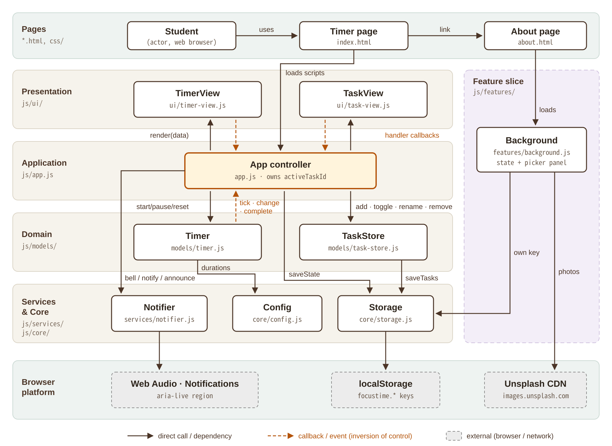
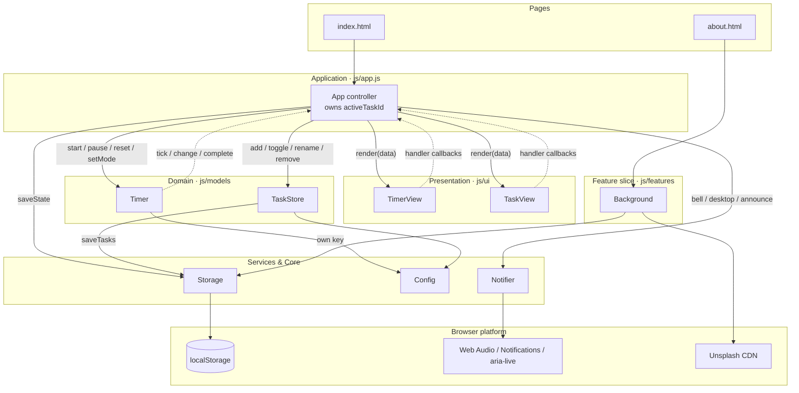
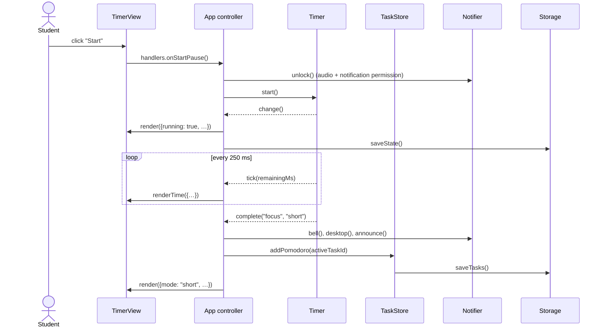

# FocusTime – Software Architecture

FocusTime is a Pomodoro timer with a task list for students. It runs entirely
in the browser: static HTML/CSS/JavaScript, no server, no build step. Data is
kept in the browser's `localStorage`.

Use cases covered (see [`use-case.png`](use-case.png)): add a task, view the
task list, mark a task as complete, choose a task to work on, start the timer
and stop the timer.

---

## 1. Architectural style

The app uses a **layered architecture** with a **Model-View-Controller**
split inside the browser:

| Layer | Folder | What it may depend on |
|---|---|---|
| Pages | `*.html`, `css/` | loads scripts |
| Presentation (View) | `js/ui/` | `Config` only |
| Application (Controller) | `js/app.js` | everything below it |
| Domain (Model) | `js/models/` | `core/` only, **never the DOM** |
| Services & Core | `js/services/`, `js/core/` | browser APIs only |
| Browser platform | — | `localStorage`, Web Audio, Notifications, Unsplash CDN |

Two rules hold the design together:

1. **Dependencies point downwards only.** A model never calls a view, and a
   view never calls a model. Only the controller knows both.
2. **Upward communication uses callbacks.** When a lower layer needs to tell
   a higher one that something happened (a timer tick, a click), it calls a
   handler that the controller passed in. This is *inversion of control*.

## 2. Architectural diagram



Source: [`architecture.svg`](architecture.svg). A text version for GitHub:



## 3. Project structure

```
focus-time/
├── index.html              Timer page (main app)
├── about.html              Static page about the Pomodoro technique
├── README.md
├── assets/
│   └── favicon.svg
├── css/
│   └── style.css           All styles (theme tokens, layout, components)
├── js/
│   ├── core/               Infrastructure: no business rules, no UI
│   │   ├── config.js         Durations, labels, cycle length, limits
│   │   └── storage.js        localStorage adapter (safe read/write)
│   ├── models/             Domain logic: pure state + rules, no DOM
│   │   ├── timer.js          Pomodoro state machine
│   │   └── task-store.js     Task CRUD + pomodoro counter
│   ├── services/           Side effects through browser APIs
│   │   └── notifier.js       Bell sound, desktop notification, screen-reader
│   ├── ui/                 Views: render data, report user actions
│   │   ├── timer-view.js     Timer card
│   │   └── task-view.js      Active / completed task lists
│   ├── features/           Self-contained, cross-page features
│   │   └── background.js     Background picker (own state + panel)
│   └── app.js              Controller / composition root
└── docs/
    ├── ARCHITECTURE.md     This document
    ├── architecture.svg    Component diagram (source)
    ├── architecture.png    Component diagram (image)
    └── use-case.png        Use-case diagram
```

## 4. Components and responsibilities

| Component | File | Responsibility | Does **not** |
|---|---|---|---|
| **Config** | `core/config.js` | Holds every tunable constant: session lengths (25/5/15 min), labels, long break every 4 sessions, tick rate, title limit. Reads the `?fast` test switch. | contain logic |
| **Storage** | `core/storage.js` | The only module that talks to `localStorage`. Serialises JSON, catches errors (private mode, quota) and falls back to defaults. | know what a task or timer is |
| **Timer** | `models/timer.js` | Pomodoro state machine: `focus → short break → … → long break`. Start, pause, reset, switch mode, count finished focus sessions. Derives time from a wall-clock deadline, so it stays accurate in background tabs and after reloads. Emits `tick`, `change` and `complete`. | touch the DOM, know about tasks |
| **TaskStore** | `models/task-store.js` | The task list: add (with validation), rename, complete/uncomplete, delete, add a pomodoro. Saves every change. | render anything |
| **Notifier** | `services/notifier.js` | Alerts the user: bell sound (Web Audio), desktop notification, screen-reader announcement (aria-live). Unlocks audio after a user gesture. | decide *when* to alert |
| **TimerView** | `ui/timer-view.js` | Draws the timer card (time, progress bar, mode tabs, cycle info, current task). Turns Start/Pause, Reset and mode clicks into handler calls. | change timer state itself |
| **TaskView** | `ui/task-view.js` | Draws the active and completed lists, the counters and empty states. Inline editing. Turns check/focus/edit/delete into handler calls. | store or change tasks |
| **App controller** | `app.js` | Composition root: wires views to models, owns the *active task* selection, handles the task form, credits a pomodoro to the active task on `complete`, triggers alerts and saves timer state. | contain domain rules or DOM-building code |
| **Background** | `features/background.js` | Self-contained feature used on every page: chooses a solid colour or Unsplash photo, keeps its own state, builds its own settings panel. | depend on timer or tasks |

### Mapping use cases to components

| Use case | View | Controller handler | Model |
|---|---|---|---|
| Add a task | task form | `form submit` | `TaskStore.add` |
| View the task list | `TaskView.render` | `renderTasks` | `TaskStore.active/completed` |
| Mark the task as complete | checkbox | `onToggle` | `TaskStore.toggleComplete` |
| Choose a task for work | Focus button | `onFocus` (sets `activeTaskId`) | — |
| Start the timer | Start button | `onStartPause` | `Timer.start` |
| Stop the timer | Pause / Reset | `onStartPause` / `onReset` | `Timer.pause` / `Timer.reset` |

## 5. How the components interact

**Commands go down, events come up.**

- *View → Controller:* each view receives a `handlers` object in `init`/`render`
  and calls it on user input (`onStartPause`, `onToggle`, `onFocus`, …).
- *Controller → Model:* plain method calls (`Timer.start()`, `TaskStore.add()`).
- *Model → Controller:* `Timer` calls the `tick`, `change` and `complete`
  listeners passed to `Timer.init`.
- *Controller → View:* the controller collects plain data from the models and
  passes it to `TimerView.render({...})` / `TaskView.render(...)`.
- *Model → Storage:* `TaskStore` saves after each change; the controller saves
  the timer state plus `activeTaskId` on every `change`.

Example: a focus session finishes and is credited to the chosen task.



### Load order

Scripts are plain `<script>` tags. Their order in `index.html` is the
dependency order, so every module only uses modules loaded before it:

```
<head>:  core/storage.js → features/background.js   (applies background before first paint)
<body>:  core/config.js → models/* → services/* → ui/* → app.js
```

## 6. Decisions and justification

| # | Decision | Why | Trade-off |
|---|---|---|---|
| D1 | **Client-only static web app**, no backend | One student, one device. Nothing needs sharing, so a server would only add hosting, accounts and failure points. Can be hosted free (GitHub Pages) or opened from disk. | No sync between devices. The `Storage` adapter keeps the door open for that. |
| D2 | **Layered architecture with MVC** | Separates *what the app does* (models) from *how it looks* (views) and *how they are connected* (controller). Each file has one reason to change. | A few more files than a single script. |
| D3 | **Models have no DOM access** | Timer and task rules are the most important logic. Without DOM access they can be checked in isolation and reused if the UI changes. | The controller has to translate model state into view data. |
| D4 | **Views are "dumb"**: render data, report actions via callbacks | Rendering can be redesigned without touching the rules. Views can't put the app in an invalid state. | Callback objects must be passed around. |
| D5 | **One controller as composition root** | All wiring is in one place, which makes the data flow easy to follow. It also owns the one piece of state that links two models: *which task is active*. So `Timer` and `TaskStore` stay unaware of each other. | The controller grows with each feature. If it gets too big, split it per use case. |
| D6 | **Observer callbacks from `Timer`** | The timer runs on its own clock and must report back without knowing who listens. This is inversion of control: lower layers stay reusable. | Slightly harder to follow than direct calls. The sequence diagram above shows the flow. |
| D7 | **Storage behind an adapter** | `localStorage` can throw (private mode, quota). Wrapping it means one place to handle errors, and one place to change for IndexedDB or a cloud API later. | — |
| D8 | **Config module** | Durations and limits are product decisions, not code. Keeping them in one place makes them easy to change. It also removed the timer's dependency on `location`. | — |
| D9 | **Background as a feature slice** | It is used on both pages, has its own state, and has nothing to do with timer/tasks. Keeping it vertical and self-contained means it can be removed or replaced by deleting one file and one `<script>` tag. | It does not follow the layer split internally. That's acceptable because it is isolated. |
| D10 | **Timer uses a wall-clock deadline, not a tick counter** | Browsers throttle timers in background tabs. Computing `endsAt − now` keeps the countdown accurate, and a session that ends while the tab is closed is finished correctly on reload. | — |
| D11 | **Plain scripts + namespace objects instead of ES modules / bundler** | Works when `index.html` is opened directly from disk (`file://`), where ES modules are blocked by CORS. No toolchain to install. Each module is an IIFE exposing one object, so internals stay private. | Dependencies are expressed by load order rather than `import`. Moving to ES modules later is mechanical: change each `const X = (() => {…})()` into `export`. |

## 7. Extending the system

- **New setting (e.g. custom durations):** add to `Config` → add a settings view in `ui/` → wire it in `app.js`. Persist through `Storage`.
- **Statistics page:** new model `models/stats.js` that reads `TaskStore`, new view `ui/stats-view.js`. No changes to `Timer`.
- **Cloud sync:** replace the inside of `core/storage.js`. Models and views stay as they are.
