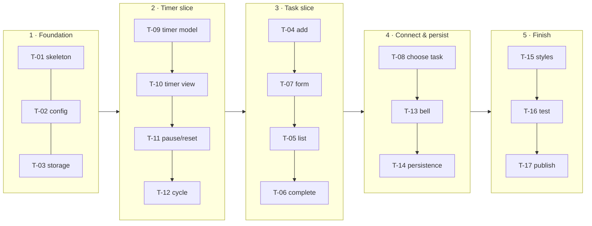
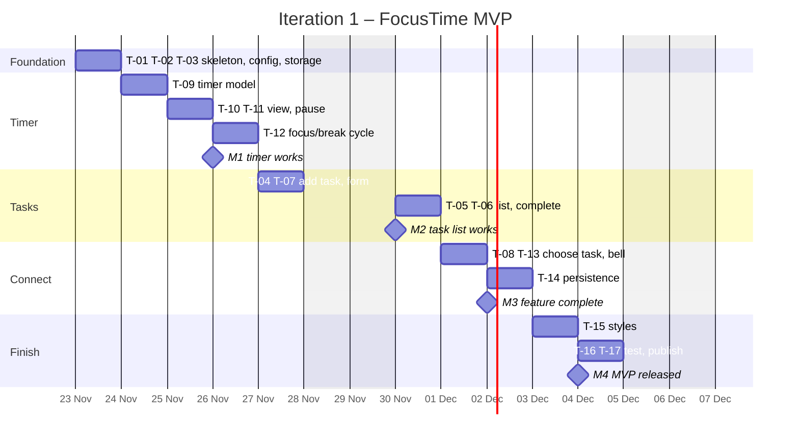

# FocusTime – MVP and Implementation Plan

This document defines the **minimum viable product (MVP)** of FocusTime, splits
its user stories into tasks, puts the tasks in order and plans the first
iteration. Module names refer to [ARCHITECTURE.md](ARCHITECTURE.md).

---

## 1. Product backlog

The backlog was compiled from the use-case diagram ([`use-case.png`](use-case.png)),
the features in the current prototype and ideas for later versions.
Every item is written as a user story for the only actor, the **student**.

**Value:** H = high, M = medium, L = low. **Effort:** story points (SP), Fibonacci scale.
**Priority (MoSCoW):** Must / Should / Could / Won't (this release).

| ID | As a student, I want to… | so that… | Value | SP | Priority |
|---|---|---|---|---|---|
| US-01 | add a task | I know what I am going to work on | H | 2 | **Must** |
| US-02 | see my task list | I get an overview of my work | H | 2 | **Must** |
| US-03 | mark a task as complete | I see my progress and the list stays short | H | 1 | **Must** |
| US-04 | choose a task to work on | the session has a clear goal | H | 2 | **Must** |
| US-05 | start a 25-minute focus timer | I can concentrate for a fixed time | H | 3 | **Must** |
| US-06 | stop the timer (pause / reset) | I can handle interruptions | H | 1 | **Must** |
| US-07 | switch to a break and back to focus automatically | I follow the Pomodoro rhythm without effort | H | 2 | **Must** |
| US-08 | hear a sound when a session ends | I notice it without watching the screen | H | 1 | **Must** |
| US-09 | still have my tasks and timer after a reload | I don't lose work when I close the tab | H | 3 | **Must** |
| US-10 | edit a task title | I can fix typos | M | 1 | Should |
| US-11 | delete a task | I can remove tasks added by mistake | M | 1 | Should |
| US-12 | see how many pomodoros I spent on each task | I can judge my effort | M | 1 | Should |
| US-13 | get a long break after 4 pomodoros | I rest properly, as the technique says | M | 1 | Should |
| US-14 | get a desktop notification when a session ends | I notice it when the tab is hidden | M | 2 | Should |
| US-15 | use the app with keyboard and screen reader | the app is accessible to everyone | M | 2 | Should |
| US-16 | switch between focus / short / long break by hand | I can take a break early | L | 1 | Could |
| US-17 | see the countdown in the browser tab title | I can check the time from another tab | L | 1 | Could |
| US-18 | change the page background | the app feels personal | L | 5 | Could |
| US-19 | read how the Pomodoro technique works | I use the app correctly | L | 1 | Could |
| US-20 | set my own session lengths | the timer fits my rhythm | M | 3 | Won't |
| US-21 | see statistics of past days | I can track my habits | M | 5 | Won't |
| US-22 | sync data between devices with an account | I can use phone and laptop | L | 13 | Won't |
| US-23 | install the app and use it offline | it works like a native app | L | 3 | Won't |

### Backlog analysis

- **Total:** 23 stories, 57 SP.
- The **6 use cases** from the diagram map to US-01 … US-06. They are the core of
  the product, so they are all *Must*.
- US-07 … US-09 are not separate use cases, but without them the use cases don't
  work in practice. A timer that never says it is done, or a list that is empty
  after a reload, would not be usable.
- *Should* items improve comfort, but the product still works without them.
- *Could* items are cosmetic or informational.
- *Won't* items need new components (settings, history, a server), so they would
  change the architecture. They are kept for later releases.

## 2. MVP definition

> **MVP:** a single web page where a student can add tasks, pick one, run a
> 25-minute focus session on it, get a signal when it ends, take a 5-minute
> break and find everything still there after closing the browser.

**MVP test:** a feature is mandatory only if, without it, a student **cannot
complete one full focus session on a chosen task and continue the next day**.

| | Stories | SP | Share of backlog |
|---|---|---|---|
| **MVP (Must)** | US-01 … US-09 | **17** | 30 % of effort, 100 % of use cases |
| Additional | US-10 … US-23 | 40 | 70 % |

### 2.1 Mandatory functions (MVP scope)

| ID | Function | Acceptance criteria |
|---|---|---|
| US-01 | Add a task | Typing a title and pressing *Add* or Enter shows it in the list. An empty title shows an error and adds nothing. Titles are trimmed and limited to 120 characters. |
| US-02 | View the task list | Active and completed tasks are shown in two lists with counters. An empty list shows a hint. |
| US-03 | Mark a task as complete | Ticking the checkbox moves the task to *Completed*; unticking moves it back. |
| US-04 | Choose a task for work | A *Focus* button selects the task. "Working on: \<title\>" appears on the timer. Completing the chosen task clears the selection. The first added task is selected automatically. |
| US-05 | Start the timer | *Start* counts down from 25:00 in mm:ss with a progress bar. The time stays correct when the tab is in the background. |
| US-06 | Stop the timer | *Pause* stops the countdown, *Resume* continues from the same time. *Reset* returns to the full duration. |
| US-07 | Automatic focus/break cycle | At 00:00 a focus session switches to a 5-minute break; a break switches back to focus. The current mode is visible. |
| US-08 | End-of-session signal | A short bell plays when any session ends. |
| US-09 | Persistence | After a reload the tasks, chosen task, mode and remaining time are restored. A session that ended while the tab was closed counts as finished. The app still works (without saving) if storage is blocked. |

### 2.2 Additional functions (after the MVP)

| Release | Stories | Theme |
|---|---|---|
| Iteration 2 | US-10, US-11, US-12, US-13, US-14, US-15 | Comfort & accessibility: full task management, long break, notifications, a11y |
| Iteration 3 | US-16, US-17, US-18, US-19 | Polish: manual mode switch, tab title, background picker, About page |
| Later | US-20, US-21, US-22, US-23 | New capabilities: settings, statistics, sync, PWA |

## 3. User stories split into tasks

Estimates are in hours (h). The **Module** column shows which component from the
architecture each task belongs to.

| Task | Story | Description | Module | h |
|---|---|---|---|---|
| T-01 | all | Page skeleton: header, timer card, task card, task form | `index.html` | 1 |
| T-02 | US-05, 07 | Config: focus 25 min, short break 5 min | `core/config.js` | 0.5 |
| T-03 | US-09 | Storage adapter: safe JSON read/write with fallback | `core/storage.js` | 1 |
| T-04 | US-01 | `TaskStore.add` with validation (trim, empty, max length) | `models/task-store.js` | 1 |
| T-05 | US-02 | `TaskView.render`: active / completed lists, counters, empty states | `ui/task-view.js` | 2 |
| T-06 | US-03 | `TaskStore.toggleComplete` + checkbox in the list | model + view | 1 |
| T-07 | US-01 | Form submit handler and error message | `app.js` | 1 |
| T-08 | US-04 | *Focus* button, `activeTaskId` in the controller, "Working on" label | view + `app.js` | 1.5 |
| T-09 | US-05 | Timer state machine: `start`, deadline-based countdown, `tick` event | `models/timer.js` | 2 |
| T-10 | US-05 | `TimerView`: mm:ss display, progress bar, Start button | `ui/timer-view.js` | 1.5 |
| T-11 | US-06 | `pause` / `resume` / `reset` + button labels and states | model + view | 1 |
| T-12 | US-07 | `finish()`: focus → break → focus, mode shown on the card | `models/timer.js` | 1.5 |
| T-13 | US-08 | `Notifier.bell` (Web Audio), unlock audio on the *Start* click | `services/notifier.js` | 1 |
| T-14 | US-09 | Save & restore tasks, chosen task and timer state (incl. deadline) | `app.js` + models | 1.5 |
| T-15 | all | Base styles: layout, responsive mobile view, visible focus | `css/style.css` | 2 |
| T-16 | all | Manual test of all acceptance criteria (Chrome, Firefox, phone width) and bug fixing | — | 2 |
| T-17 | all | Publish on GitHub Pages, write README | — | 0.5 |
| | | **Total** | | **22** |

## 4. Order of execution

The order follows three rules:

1. **Dependencies first.** Core modules → models → views → controller wiring.
2. **Riskiest part early.** The timer is the core value and the hardest to get
   right (background tabs, accuracy), so it comes before the task list.
3. **Always runnable.** Each phase ends with something that can be opened and
   tried in the browser.

| Phase | Tasks | Result you can try |
|---|---|---|
| 1. Foundation | T-01, T-02, T-03 | Static page with all sections |
| 2. Timer slice | T-09, T-10, T-11, T-12 | **M1:** timer counts down, pauses, resets and switches to a break |
| 3. Task slice | T-04, T-07, T-05, T-06 | **M2:** tasks can be added, listed and completed |
| 4. Connect & persist | T-08, T-13, T-14 | **M3:** feature complete. Choose a task, hear the bell, reload without losing data |
| 5. Finish | T-15, T-16, T-17 | **M4:** tested, styled, published MVP |

T-08 needs both the timer and the task list, so it comes after them. T-14 comes
last in its phase because it saves the state that all earlier tasks create.

## 5. Plan for iteration 1

| | |
|---|---|
| **Iteration** | 1 (MVP) |
| **Dates** | Mon 23 Nov 2026 – Fri 4 Dec 2026 (2 weeks, 10 working days) |
| **Goal** | Release a working FocusTime that covers all six use cases |
| **Scope** | US-01 … US-09 (17 SP), tasks T-01 … T-17 |
| **Capacity** | 24 h (about 2.5 h per working day) |
| **Planned** | 22 h + 2 h buffer for bugs and estimation errors |

### Schedule

| Day | Date | Tasks | h | Milestone |
|---|---|---|---|---|
| 1 | Mon 23 Nov | Iteration planning, T-01, T-02, T-03 | 2.5 | |
| 2 | Tue 24 Nov | T-09 | 2 | |
| 3 | Wed 25 Nov | T-10, T-11 | 2.5 | |
| 4 | Thu 26 Nov | T-12 | 1.5 | **M1** timer works |
| 5 | Fri 27 Nov | T-04, T-07 | 2 | |
| 6 | Mon 30 Nov | T-05, T-06 | 3 | **M2** task list works |
| 7 | Tue 1 Dec | T-08, T-13 | 2.5 | |
| 8 | Wed 2 Dec | T-14 | 1.5 | **M3** feature complete |
| 9 | Thu 3 Dec | T-15 | 2 | |
| 10 | Fri 4 Dec | T-16, T-17, review & demo | 2.5 | **M4** MVP released |

### Definition of Done

A story is done when:

- all its acceptance criteria (section 2.1) pass in Chrome and Firefox;
- it works at 360 px phone width and with the keyboard;
- there are no errors in the browser console;
- the code sits in the module given by the architecture;
- the change is committed with a clear message.

### Risks

| Risk | Impact | Mitigation |
|---|---|---|
| Browsers slow down timers in background tabs | Wrong time shown | Compute time from a deadline (`endsAt − now`), not by counting ticks (T-09) |
| Browsers block sound without a user action | No bell (US-08 fails) | Create the audio context on the *Start* click (T-13) |
| `localStorage` blocked (private mode) | Crash on load | Wrap every access in try/catch with defaults (T-03) |
| Estimates too low | Iteration not finished | 2 h buffer. If still late, cut T-15 to basic styles; never cut a *Must* story |
| Scope creep (adding *Should* items early) | MVP late | New ideas go into the backlog for iteration 2, not into this iteration |

### Iteration review

On 4 Dec the MVP is shown with this scenario (it covers every *Must* story):

1. Add three tasks; try an empty title → error.
2. Choose the second task, start the timer (use `?fast` so minutes become seconds).
3. Pause, resume, then let it finish → bell, switch to break.
4. Reload the page → tasks, chosen task and timer are restored.
5. Mark the task as complete → it moves to *Completed* and the selection clears.

After the review, the backlog is re-prioritised and iteration 2 (section 2.2) is planned.
